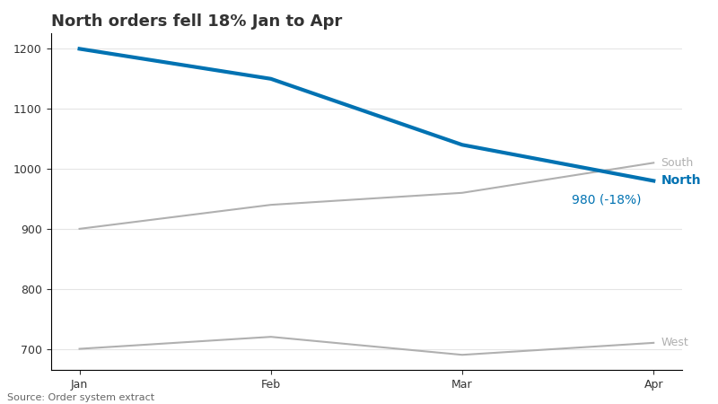

# insight-first-charts

Companion code for the dataa.dev article *Data Storytelling: Lead With the Finding, Then Show the Evidence* (11 May 2024).

`insight_chart.py` draws a line chart the way the article recommends: the title states the finding ("North orders fell 18% Jan to Apr"), one series is highlighted in a colour-blind-safe blue, the others are grey context, lines are labelled directly instead of through a legend, and the source is shown. The choices are in code so they can be reviewed and reused.



## Use

```bash
pip install matplotlib==3.8.4 numpy==1.26.4
python example.py   # writes example.png
```

## Tests

```bash
pip install matplotlib==3.8.4 numpy==1.26.4 contourpy==1.2.1 pytest==8.2.0
python -m pytest -q
```

4 tests: headline wording for rises, falls and flat series, rejection of percentage change from zero, and the rendered chart's title, colours, line order and width, direct labels, absent legend and source note. Tested with Python 3.12.
