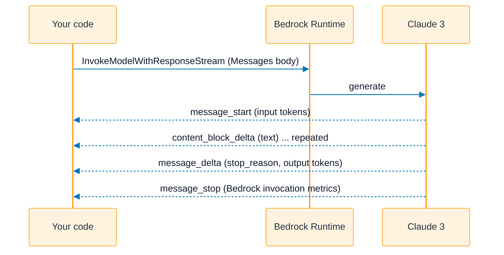

# Claude 3 on Amazon Bedrock: Moving from Text Completions to the Messages API

*Saturday 16 March 2024. Slug `claude-3-bedrock-text-completions-to-messages-api`*

**Excerpt:** Claude 3 Sonnet and Haiku on Bedrock accept only the Messages API. A converter for Claude 2 prompts, the prefill and streaming changes that break existing code, and every request checked against Anthropic's own SDK of March 2024.

Anthropic released the Claude 3 models on 4 March 2024, and Claude 3 Sonnet was on Amazon Bedrock the same day, in US East (N. Virginia) and US West (Oregon). Claude 3 Haiku followed on 13 March, and Claude 3 Opus is due in the coming weeks. On paper the move from Claude 2.1 is a model ID change. In practice it is an API change: Claude 3 does not accept the Text Completions request that every Claude 2 integration on Bedrock was written against.

Send a Claude 2 request body to a Claude 3 model ID and `InvokeModel` answers with a ValidationException saying the model is not supported on this API and to use the Messages API instead. Anything that builds a `prompt` string with `\n\nHuman:` and `\n\nAssistant:` markers has to change before it can use the new models. This article covers what changes, a converter for existing prompts, streaming, and the cost case, with every request checked against Anthropic's own SDK.

## What changed in the request

A Text Completions request is one string plus a few parameters. The model was trained on conversations written as `\n\nHuman:` and `\n\nAssistant:` turns, so the prompt had to be in that form, and callers added `\n\nHuman:` as a stop sequence so the model would not write the user's next line as well. A Messages request separates those things:

- `system` is a top-level field. In Claude 2, a system prompt was whatever text came before the first Human turn.
- `messages` is a list of turns with a `role` of `user` or `assistant`, starting with `user` and alternating.
- Each turn's `content` is a string or a list of blocks. Text blocks and, for Claude 3, base64 image blocks.
- `max_tokens` replaces `max_tokens_to_sample` and is required. `anthropic_version` must be `bedrock-2023-05-31`.
- `temperature`, `top_p`, `top_k` and `stop_sequences` keep their meaning.


*The whole migration on one page.*

The response changes too. `completion` becomes `content`, a list of blocks, so code that read one string has to join the text blocks. `stop_reason` gains `end_turn` for a normal finish. And every response now carries `usage` with input and output token counts, which Text Completions never returned in the body.

## Converting existing prompts

Most teams have prompts in code, templates or a database, written for Claude 2. Rewriting them by hand is a risk of its own, because a prompt that has been tuned over months is easy to change by accident. A mechanical conversion keeps the wording identical and moves only the structure:

```python
def parse_prompt(prompt: str) -> tuple[str | None, list[dict]]:
    """Return (system, messages). Consecutive turns from the same role are merged."""
    parts = _TURN.split(prompt)
    system = parts[0].strip() or None
    if len(parts) < 3:
        raise PromptFormatError("no '\\n\\nHuman:' turn found")
    messages: list[dict] = []
    for marker, text in zip(parts[1::2], parts[2::2]):
        role = "user" if marker == HUMAN else "assistant"
        text = text.strip()
        if messages and messages[-1]["role"] == role:
            messages[-1]["content"] += "\n\n" + text
        else:
            messages.append({"role": role, "content": text})
    if messages[0]["role"] != "user":
        raise PromptFormatError("the first turn must be Human")
    if parts[-2] != ASSISTANT:
        raise PromptFormatError("the prompt must end with '\\n\\nAssistant:'")
    # An empty final "Assistant:" just asks for the answer; text there is a prefill and stays.
    if messages[-1]["role"] == "assistant" and not messages[-1]["content"]:
        messages.pop()
    for m in messages:
        if not m["content"]:
            raise PromptFormatError(f"empty {m['role']} turn")
    return system, messages
```

Three details matter. Text before the first Human turn is the system prompt, which is how Claude 2 treated it. Two Human turns in a row, which Claude 2 tolerated, become one user message, because the Messages API requires alternating roles. And text after the final `\n\nAssistant:` is a prefill, the opening of the answer the caller wants continued, so it stays as a final assistant message instead of being dropped.

The request body around it is a direct mapping, with one deliberate omission:

```python
def convert_body(old: dict) -> dict:
    """Map a Text Completions request body to a Messages request body."""
    system, messages = parse_prompt(old["prompt"])
    new: dict = {"anthropic_version": ANTHROPIC_VERSION, "max_tokens": old["max_tokens_to_sample"],
                 "messages": [{"role": m["role"], "content": [{"type": "text", "text": m["content"]}]} for m in messages]}
    if system:
        new["system"] = system
    # "\n\nHuman:" was a stop sequence because the model wrote both sides; the Messages API ends turns itself.
    stops = [s for s in old.get("stop_sequences", []) if s.strip() != "Human:"]
    if stops:
        new["stop_sequences"] = stops
    for key in ("temperature", "top_p", "top_k"):
        if key in old:
            new[key] = old[key]
    return new
```

`\n\nHuman:` was a stop sequence only because the model wrote both sides of the conversation. The Messages API ends the assistant's turn itself, so keeping it would do nothing useful; the converter drops it and keeps any other stop sequences. This is what the demo prints for a summary prompt with a system instruction:

```text
== summary with a system prompt
Text Completions body:
{
  "prompt": "You summarise clinical notes in one sentence. Never add facts.\n\nHuman: <note>Admitted with chest pain. Troponin negative twice. Discharged day 3 on aspirin.</note>\n\nAssistant:",
  "max_tokens_to_sample": 200,
  "stop_sequences": [
    "\n\nHuman:"
  ],
  "temperature": 0.0
}
Messages body:
{
  "anthropic_version": "bedrock-2023-05-31",
  "max_tokens": 200,
  "messages": [
    {
      "role": "user",
      "content": [
        {
          "type": "text",
          "text": "<note>Admitted with chest pain. Troponin negative twice. Discharged day 3 on aspirin.</note>"
        }
      ]
    }
  ],
  "system": "You summarise clinical notes in one sentence. Never add facts.",
  "temperature": 0.0
}
```

## Prefill still works, with one change

Prefill is the most useful trick from Claude 2 prompts: end the prompt with the start of the answer, such as an opening brace, and the model continues from there. The Messages API keeps it as a final assistant message. This is the converted body for a JSON extraction prompt:

```json
{
  "anthropic_version": "bedrock-2023-05-31",
  "max_tokens": 100,
  "messages": [
    {
      "role": "user",
      "content": [
        {
          "type": "text",
          "text": "Extract the medication names from: aspirin 75 mg, atorvastatin 40 mg."
        }
      ]
    },
    {
      "role": "assistant",
      "content": [
        {
          "type": "text",
          "text": "{\"medications\": ["
        }
      ]
    }
  ],
  "stop_sequences": [
    "]}"
  ]
}
```

The change is in the response. The model returns only the continuation, not the prefill, so code that parses the reply as JSON must put the prefill back in front first. The sample's response parser takes the prefill as an argument and does that, for whole and streamed responses alike. Forgetting it is the most likely bug in a migrated JSON pipeline: every reply fails to parse, and the cause is not obvious from the model's output.

Prompts that were never in the right form get refused rather than guessed at:

```text
== prompt with no Human turn
Text Completions body:
{
  "prompt": "Summarise this: aspirin 75 mg daily.",
  "max_tokens_to_sample": 100
}
Messages body:
  refused: no '\n\nHuman:' turn found
```

## Streaming

Streaming changes more than the request does. A Claude 2 stream sent chunks containing a `completion` fragment and finally a `stop_reason`. A Claude 3 stream sends typed events, and the text is only in some of them:



`message_start` carries the input token count, `content_block_delta` events carry the text, `message_delta` carries the stop reason and output token count, and Bedrock adds its own invocation metrics to `message_stop`. Code that concatenated every chunk's `completion` field now gets nothing back. The sample folds the events into one result:

```python
def from_stream(events, prefill: str = "") -> Result:
    """Fold the decoded stream events (message_start ... message_stop) into one Result."""
    pieces, stop_reason, stop_sequence, input_tokens, output_tokens, extra = [prefill], None, None, 0, 0, {}
    for event in events:
        kind = event.get("type")
        if kind == "message_start":
            input_tokens = event["message"]["usage"].get("input_tokens", 0)
        elif kind == "content_block_delta" and event["delta"].get("type") == "text_delta":
            pieces.append(event["delta"]["text"])
        elif kind == "message_delta":
            stop_reason = event["delta"].get("stop_reason")
            stop_sequence = event["delta"].get("stop_sequence")
            output_tokens = event.get("usage", {}).get("output_tokens", output_tokens)
        elif kind == "message_stop" and "amazon-bedrock-invocationMetrics" in event:
            extra = event["amazon-bedrock-invocationMetrics"]
    return Result("".join(pieces), stop_reason, stop_sequence, input_tokens, output_tokens, extra)
```

The client around it is small. It uses Bedrock Runtime's two operations, the only ones it had in March 2024, and lets botocore's adaptive retry mode handle throttling, which is the usual first error on a newly launched model:

```python
# Throttling is the usual failure on a new model; let botocore back off and retry.
RETRY = Config(retries={"max_attempts": 8, "mode": "adaptive"}, read_timeout=120)


class ClaudeOnBedrock:
    def __init__(self, model_id: str = SONNET, client=None, region: str = "us-east-1"):
        self.model_id = model_id
        self.client = client or boto3.client("bedrock-runtime", region_name=region, config=RETRY)

    def invoke(self, body: dict) -> Result:
        response = self.client.invoke_model(modelId=self.model_id, body=json.dumps(body),
                                            contentType="application/json", accept="application/json")
        result = from_message(json.loads(response["body"].read()), prefill_of(body))
        log.info("model=%s in=%d out=%d stop=%s", self.model_id, result.input_tokens, result.output_tokens,
                 result.stop_reason)
        return result

    def stream(self, body: dict) -> Result:
        response = self.client.invoke_model_with_response_stream(
            modelId=self.model_id, body=json.dumps(body), contentType="application/json", accept="application/json")
        events = (json.loads(part["chunk"]["bytes"]) for part in response["body"] if "chunk" in part)
        return from_stream(events, prefill_of(body))
```

## Images in the request

Claude 3 accepts images, which Claude 2 never did, and the Messages API is the only way to send them. An image is a content block inside a user message, next to the text blocks. On Bedrock it has to be in the request body as base64; there is no option to pass a URL or an S3 location, so the application reads the bytes and encodes them itself:

```python
def image_block(data: bytes, media_type: str) -> dict:
    """An image as Claude 3 takes it on Bedrock: base64 in the request body, no URLs."""
    if media_type not in IMAGE_TYPES:
        raise ValueError(f"unsupported media type {media_type}")
    return {"type": "image", "source": {"type": "base64", "media_type": media_type,
                                        "data": base64.b64encode(data).decode("ascii")}}


def user_message
```

JPEG, PNG, GIF and WebP are accepted. Base64 adds about a third to the size, and the whole request body has a size limit, so large photos should be resized before encoding; this also reduces input tokens, because an image is charged by its pixel dimensions. The sample's test builds a message with a 1x1 PNG and a question, sends it through Anthropic's Bedrock client and checks that the body is identical to the one built by hand. It also checks that an unsupported type such as TIFF is refused before any request is made.

Image input changes more than the request shape. A prompt that used to describe a document in words can now include the page itself, and that is a product decision, not part of the migration. Treat it as a separate change after the API move is done and tested.

## Errors to expect

The API change does not change how Bedrock reports failures, but a migration exercises the error paths more than usual: new model IDs, new account permissions and new quotas all arrive at once. The service model in botocore 1.34.64 lists these errors for `InvokeModel`, as printed in the CI run below. Three of them matter most during a move:

- **ValidationException** is the error for a Text Completions body sent to Claude 3, and for a Messages body that breaks a rule, such as two user messages in a row, an empty content block or a missing `max_tokens`. Treat it as a bug, never retry it.
- **AccessDeniedException** usually means model access has not been granted for this model in this account and Region. It is fixed in the console, not in code.
- **ThrottlingException** is normal on a new model with default quotas. Retry with backoff, which is what the adaptive retry mode does, and request a quota increase before moving production traffic.

`ModelTimeoutException` and `ModelErrorException` are rarer and worth a single retry. Log the request ID from every failure; it is what AWS Support asks for first.

## Test setup

These tests do not call Bedrock, so they say nothing about what Claude 3 writes. They check the part a migration can get wrong: the shape of every request and response. The reference is Anthropic's own Python SDK, version 0.20.0, the release available on 15 March 2024, which has an `AnthropicBedrock` client that signs requests for Bedrock. The tests replace its network layer with a stub that records what it would send. This is what the installed SDKs offered:

```json
{
  "botocore": "1.34.64",
  "bedrock-runtime operations": [
    "InvokeModel",
    "InvokeModelWithResponseStream"
  ],
  "anthropic": "0.20.0",
  "InvokeModel errors": [
    "AccessDeniedException",
    "InternalServerException",
    "ModelErrorException",
    "ModelNotReadyException",
    "ModelTimeoutException",
    "ResourceNotFoundException",
    "ServiceQuotaExceededException",
    "ThrottlingException",
    "ValidationException"
  ],
  "AnthropicBedrock resources": [
    "completions",
    "messages"
  ]
}
```

The central test builds the same request two ways, with the converter and with Anthropic's client, and requires the two JSON bodies to be identical:

```python
def test_converted_body_is_exactly_what_the_sdk_sends_for_messages():
    new = convert_body(OLD)
    seen = {}
    sdk(capture(seen)).messages.create(model=SONNET, max_tokens=new["max_tokens"], system=new["system"],
                                       messages=new["messages"], temperature=new["temperature"])
    assert seen["path"] == f"/model/{SONNET}/invoke"
    assert seen["body"] == new
```

Other tests feed a documented response through the SDK and through the sample's parser and compare the results, and run the request through botocore's Stubber, which validates the operation's parameters against the Bedrock Runtime service model. For streaming, the tests encode a real AWS event stream, the binary framing with CRC checksums that Bedrock uses, and give the same bytes to botocore's decoder and to the Anthropic SDK's. Both produce the same event sequence and the same text. All 16 tests passed in GitHub Actions on Python 3.12 with boto3 1.34.64.

## What it costs

The price case is clear even before any quality comparison. The demo prices one month of 50 million input and 10 million output tokens on each model at Bedrock's on-demand rates in US East (N. Virginia):

```text
== One month: 50,000,000 input and 10,000,000 output tokens, on-demand, US East (N. Virginia)
  Claude Instant 1.2   $     64.00
  Claude 2.0 / 2.1     $    640.00
  Claude 3 Sonnet      $    300.00
  Claude 3 Haiku       $     25.00
```


*Same tokens, four models.*

Claude 3 Sonnet costs less than half of Claude 2.1 for the same tokens, and Claude 3 Haiku costs less than Claude Instant. Both also have a 200,000-token context window. A real workload's token counts will move a little between models, because the tokenizers and the length of answers differ, so measure on your own traffic. This calculation only shows that the price is not the obstacle.

## Planning the migration

- **Find every Text Completions call.** Search for `max_tokens_to_sample` and `\n\nHuman:`; together they find almost every call site and prompt template.
- **Convert prompts mechanically first.** Keep the wording; change only the structure. Tune prompts for Claude 3 later, as a separate change you can measure.
- **Fix response handling.** Join text blocks, re-attach prefills, and map stop reasons where downstream code checks them. The sample's `Result.legacy()` returns the old shape for callers you cannot change yet.
- **Rewrite stream consumers.** Read text from `content_block_delta` events only.
- **Request model access.** Each Claude 3 model needs access granted in the Bedrock console, per account and Region, before the first call.
- **Compare outputs before switching traffic.** Run the same inputs through Claude 2.1 and Claude 3 and review the differences; a cheaper model that answers differently is still a change to your product.
- **Use the token counts.** `usage` in every response makes per-request cost tracking possible without estimating.

> **CLAUDE 2 STILL WORKS**  
> Nothing here forces a migration today: Claude Instant, Claude 2.0 and Claude 2.1 keep working with Text Completions, and they also accept the Messages API. Moving Claude 2 callers to the Messages API first, without changing the model, separates the API change from the model change and makes each one easier to test.

## Decision framework

| Situation | Recommendation |
| :--- | :--- |
| New feature on Bedrock | Start with the Messages API and Claude 3 Sonnet or Haiku |
| Existing Claude 2.1 feature, cost matters | Move to the Messages API, then compare Claude 3 Sonnet on your own inputs |
| High-volume classification or extraction on Claude Instant | Try Claude 3 Haiku: cheaper per token and a much larger context |
| Prompts that end with a prefill | Keep the prefill as an assistant message and add it back to the reply |
| Streaming user interface | Rewrite the stream reader for typed events before switching models |
| Needs the most capable model | Wait for Claude 3 Opus on Bedrock; it was announced but not yet available |

> **HOW THIS WAS CHECKED**  
> The sample ran in GitHub Actions ([run](https://github.com/nithinmohantk/blog-samples-working-repo/actions/runs/44386686277)) on Python 3.12 with boto3 and botocore 1.34.64, Anthropic SDK 0.20.0, httpx 0.27.0 and pytest 8.1.1, the versions available on 15 March 2024. All 16 tests passed; the demo output and SDK listing above are copied from that run. No request reached Bedrock: request and response shapes were checked against Anthropic's SDK and botocore, and response contents are synthetic. Prices are Bedrock's on-demand rates for US East (N. Virginia) as published in March 2024.

## Key takeaways

- Claude 3 on Bedrock accepts only the Messages API; a Claude 2 Text Completions body is rejected with a ValidationException.
- Converting prompts is mechanical: text before the first Human turn becomes system, turns become messages, and a trailing Assistant text stays as a prefill.
- The reply does not repeat a prefill; put it back before parsing.
- Streams now arrive as typed events, and text is only in content_block_delta.
- For the same tokens, Claude 3 Sonnet costs less than half of Claude 2.1, and Haiku less than Claude Instant.

If your migration turned up a prompt pattern the converter does not handle, let me know in the comments below.

> **GET THE CODE**  
> [https://github.com/nithinmohantk/blog-samples-working-repo/tree/main/claude3-bedrock-messages-migration](https://github.com/nithinmohantk/blog-samples-working-repo/tree/main/claude3-bedrock-messages-migration)

## Glossary

- **Amazon Bedrock**: AWS's managed service for foundation models, called through the Bedrock Runtime API.
- **Text Completions API**: Anthropic's original API: one prompt string in Human and Assistant form, one completion string out.
- **Messages API**: Anthropic's API with a system field and a list of user and assistant messages made of content blocks.
- **anthropic_version**: Required request field on Bedrock; bedrock-2023-05-31 for the Messages API.
- **System prompt**: Instructions that apply to the whole conversation; a top-level field in the Messages API.
- **Prefill**: Text placed at the start of the assistant's turn so the model continues from it.
- **Content block**: One part of a message, such as a text block or an image block.
- **Stop sequence**: A string that ends generation when the model produces it.
- **InvokeModelWithResponseStream**: The Bedrock Runtime operation that returns the response as an AWS event stream.
- **AWS event stream**: AWS's binary framing for streamed responses, with headers and CRC checksums per message.
- **Stubber**: A botocore utility that returns canned responses and checks request parameters against the service model.

## References & Further Reading

- [Claude 3 Sonnet model now available on Amazon Bedrock](https://aws.amazon.com/about-aws/whats-new/2024/03/anthropics-claude-3-sonnet-model-amazon-bedrock): What's New, 4 March 2024
- [Claude 3 Haiku model now available on Amazon Bedrock](https://aws.amazon.com/about-aws/whats-new/2024/03/anthropics-claude-3-haiku-model-amazon-bedrock): What's New, 13 March 2024
- [Anthropic Claude Messages API on Bedrock](https://docs.aws.amazon.com/bedrock/latest/userguide/model-parameters-anthropic-claude-messages.html): Request and response fields, and migrating from Text Completions
- [Anthropic Claude Text Completions API on Bedrock](https://docs.aws.amazon.com/bedrock/latest/userguide/model-parameters-anthropic-claude-text-completion.html): The Claude 2 request format
- [Migrating from Text Completions](https://docs.anthropic.com/claude/reference/migrating-from-text-completions-to-messages): Anthropic's migration guide
- [Anthropic Python SDK](https://github.com/anthropics/anthropic-sdk-python): Includes the AnthropicBedrock client used as the reference
- [Amazon Bedrock pricing](https://aws.amazon.com/bedrock/pricing/): On-demand prices per 1,000 tokens
- [Sample code for this article](https://github.com/nithinmohantk/blog-samples-working-repo/tree/main/claude3-bedrock-messages-migration): Converter, client, stream parser, cost model and tests
